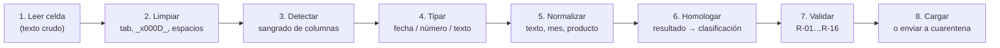

# 02. Mapeo Origen → Destino

**Proyecto:** Gestión Diaria Promigas
**Esquema de base de datos:** `gestion_diaria`
**Alcance:** las 16 tablas de datos del esquema `gestion_diaria`
**Fecha:** 19 de octubre de 2026
**Estado:** Borrador para revisión del equipo

---

## 1. Propósito

Este documento es **la especificación de la ingesta**: para cada columna del Excel
origina, a qué tabla y campo de la base de datos llega y qué transformación se le
aplica (renombrar, convertir fecha, limpiar texto, homologar valor).

Es el documento que se convierte en código. Si una carga falla, se revisa aquí primero.

**Regla de oro derivada de la evidencia** (H-24, H-25): *el mapeo no se puede asumir por
analogía entre gaseras.* El mismo nombre de columna llega con distinto contenido en
CEO, Efigas, Caribe, GDO y Surtigas. Cada archivo se mapea y **se valida por separado**.

---

## 2. Orden de las transformaciones

El orden importa: cada paso consume el resultado del anterior.



| Paso | Qué hace | Por qué en ese orden |
| ---: | :--- | :--- |
| 1 | Lee la celda como texto, sin interpretar | La interpretación prematura destruye el valor original (H-25) |
| 2 | Quita tabuladores, `_x000D_`, espacios dobles, recorta | H-25, H-26: son artefactos del portapapeles, no del dato |
| 3 | **Detecta sangrado de columnas** | Un tabulador = dos columnas pegadas. Se separa y se marca la fila |
| 4 | Tipa fecha / número / texto con funciones tolerantes | Many fuentes traen fecha como texto con 4 formatos distintos |
| 5 | Normaliza texto, mes, producto, aseguradora | Reutiliza las funciones ya existentes en la BD |
| 6 | Homologa el resultado contra `clasificacion` | Un resultado desconocido va a `POR_REVISAR`, nunca a NO APTA |
| 7 | Aplica las reglas de validación | Un registro inválido va a cuarentena, no se descarta |
| 8 | Carga o registra en cuarentena | Trazabilidad: toda fila o entra o queda registrada |

---

## 3. Funciones de normalización ya disponibles en la BD

Se reutilizan tal cual; **no reimplementar en Python**.

| Función | Qué hace | Debilidad conocida |
| :--- | :--- | :--- |
| `normalizar_texto(text)` | Minúsculas, quita tildes, colapsa espacios, normaliza ` + ` | 🔴 **No normaliza la `/`** → `cancelado/reintegro` no coincide con `cancelado /reintegro` (H-32) |
| `fn_parse_fecha(text)` | `YYYY-MM-DD`, `DD/MM/YYYY`, `DD-MM-YYYY` → `date` | 🔴 No cubre `MMM-YY`, `DD/MM/YYYY HH:MM:SS AM/PM` ni seriales de Excel |
| `normalizar_aseguradora(text)` | → ALFA / HDI / SURAMERICANA / PROEXEQUIAL / NO APLICA / OTROS / SIN REGISTRO | Cubre 6 aseguradoras; el resto cae en `OTROS` |
| `normalizar_producto(text)` | → 16 valores canónicos | No cubre `SEGURO DEUDOR` ni `LINK MARKETING` |

> **Correcciones pendientes:** extender `normalizar_texto` para la `/` y extender
> `fn_parse_fecha` para los 3 formatos faltantes (P-11b). Son cambios de few líneas.

---

## 4. Reglas de limpieza de texto (nuevas, por H-25 y H-26)

| Regla | Regla SQL / Python | Motivo |
| :--- | :--- | :--- |
| L-01 | `replace(valor, E'\t', ' ')` | Un tabulador = columnas pegadas (H-25) |
| L-02 | `replace(valor, '_x000D_', '')` | Escape de retorno de carro de Excel (H-26) |
| L-03 | `replace(valor, E'\n', ' ')` y `E'\r', ' '` | Saltos de línea dentro de la celda (740 celdas) |
| L-04 | `regexp_replace(valor, '\s+', ' ', 'g')` | Espacios múltiples (incluye el doble espacio de `CANCELADO  POR JOB`) |
| L-05 | `btrim(valor)` | Espacios al inicio y final |
| L-06 | `NULLIF(btrim(valor), '')` | Cadena vacía → NULL, no `''` |
| L-07 | Preservar el valor original en `<campo>_raw` | Nunca se modifica el dato que escribió el asesor (P-03) |

---

## 5. Mapeo por archivo

### 5.1 CEO — `Gestion diaria CEO.xlsx`

**Hoja `Gestion Diaria Inbound Ceo` → tabla `ceo_inbound` (2.749 filas)**

| # | Columna en Excel | Campo destino | Tipo destino | Transformación |
| ---: | :--- | :--- | :--- | :--- |
| 1 | *(ninguna)* | `id` | serial | PK sintética. **No usar el ID del Excel.** |
| 2 | `DISTRIBUIDORA` | `distribuidora` | varchar(100) | Constante `CEO`. Validar contra el catálogo. |
| 3 | `ASEGURADORA` | `aseguradora` | varchar(200) | L-01..L-06. Conservar cruda. |
| 4 | `MEDIO DE RECEPCION` | `medio_de_recepcion` | varchar(200) | L-01..L-06. **Hoy 100% nula**: no llega del Excel. |
| 5 | `CONTRATO` | `contrato` | varchar(200) | Trim. **No castear a número**: hay ceros a la izquierda. |
| 6 | `LOCALIDAD` | `localidad` | varchar(200) | L-01..L-06. **97.3% nula.** |
| 7 | `OPERADOR` | `operador` | varchar(200) | ⚠️ **Es la empresa operadora, no una persona** (H-23). Detectar sangrado (§6). |
| 8 | `CANAL` | `canal` | varchar(200) | L-01..L-06. Detectar sangrado. |
| 9 | `PRODUCTO` | `producto` | varchar(200) | L-01..L-06. `producto_norm` = `normalizar_producto(producto)`. |
| 10 | `TIPO DE CONTACTO` | `tipo_de_contacto` | varchar(300) | L-01..L-06. Detectar sangrado. |
| 11 | `ESTADO` | `estado` | varchar(200) | L-01..L-06. **NUNCA se modifica.** Alimenta la homologación (§7). |
| 12 | `SUBTIPIFICACION` | `subtipificacion` | varchar(300) | L-01..L-06. **100% vacía en el origen.** |
| 13 | `MOTIVO` | `motivo` | text | L-01..L-03 (3 filas con salto de línea). |
| 14 | `FECHA DE EJECUCION` | `fecha_de_ejecucion` | date | `fn_parse_fecha`. ⚠️ **1 fila con año 3748 → cuarentena (R-01).** |
| 15 | `FECHA BASE` | `base` | varchar(200) | **No usar para análisis.** Solo trazabilidad del lote. |
| 16 | `FECHA DE VENTA` | `fecha_de_venta` | date | `fn_parse_fecha`. Eje temporal distinto al de gestión. |
| 17 | `ASESOR DE VENTA` | `asesor_de_venta` | varchar(300) | L-01..L-06. **No es el asesor de retención.** |
| 18 | `MES` | `mes` | varchar(50) | Upper. Validar contra catálogo de 12 meses (R-05). |
| 19 | `CABINA` | `cabina` | varchar(20) | Constante `INBOUND`. |
| 20 | `ANIO` | `anio` | integer | ⚠️ **Año de venta.** Renombrar a `anio_venta` en el modelo nuevo. |
| 21 | *(agregada por la carga)* | `fecha_carga` | timestamp | `now()`. |
| 22 | *(derivada)* | `resultado_normalizado` | text | `clasificacion.resultado_normalizado` vía LEFT JOIN. |
| 23 | *(derivada)* | `clasificacion` | text | `clasificacion.clasificacion` vía LEFT JOIN. |

**Hoja `Abandono` → tabla `ceo_abandono` (4.020 filas)**

| # | Columna en Excel | Campo destino | Tipo destino | Transformación |
| ---: | :--- | :--- | :--- | :--- |
| 1 | *(ninguna)* | `id` | serial | PK sintética |
| 2 | `ASEGURADORA` | `aseguradora` | varchar(200) | L-01..L-06 |
| 3 | `NOMBRE CLIENTE` | `nombre_cliente` | varchar(300) | L-01..L-06 ⚠️ PII |
| 4 | `IDENTIFICACION USUARIO` | `identificacion_usuario` | bigint | Solo dígitos. No nulo → NULL. ⚠️ PII |
| 5 | `CONTRATO` | `contrato` | bigint | Solo dígitos. No nulo → NULL. |
| 6 | `LOCALIDAD` | `localidad` | varchar(200) | L-01..L-06. **86.9% nula.** |
| 7 | `TELEFONO` | `telefono` | bigint | Solo dígitos. No nulo → NULL. |
| 8 | `RESULTADO LLAMADA` | `resultado_llamada` | varchar(300) | L-01..L-06 |
| 9 | `FECHA LLAMADA` | `fecha_llamada` | date | `fn_parse_fecha`. **62.4% nula** → esas filas no son analizables por fecha. |
| 10 | `HORA` | `hora` | varchar(30) | Texto libre (`10:01:10 a. m.`). **Parsear a `time` en el modelo nuevo.** |
| 11 | *(agregada)* | `fecha_carga` | timestamp | `now()` |

---

### 5.2 Efigas — `Gestion Diaria Outbound - Efigas.xlsx`

**Hoja `base efigas` → tabla `efigas_outbound` (999 filas)**

Mapeo **idéntico** a `ceo_inbound` en las 21 columnas del bloque común, con 3 diferencias:

| # | Campo | Diferencia respecto a CEO | Transformación |
| ---: | :--- | :--- | :--- |
| 1 | `distribuidora` | Constante `EFIGAS` | — |
| 2 | `cabina` | Constante `OUTBOUND` | — |
| 14 | `fecha_de_ejecucion` | **172 nulas (17.2%)** | `fn_parse_fecha`; las nulas van a cuarentena con R-02 |
| 15 | `base` | ⚠️ **34 lotes distintos con formatos mezclados** | Se conserva como texto; **nunca** se castea a fecha |

> **Regla Efigas (H-27, confirmada con datos):** `FECHA BASE` es la fecha de carga del
> lote. El lote `2026-03-02` contiene ejecuciones de septiembre a noviembre. El
> `FECHA DE EJECUCION` es la única fecha válida para análisis.

---

### 5.3 Gas Caribe — 2 libros

**`Gestion diaria Inbound -gases del caribe.xlsx`, pestañas `Enero 2026`…`Septiembre 2026` → `caribe_inbound` (6.797 filas)**

| # | Campo | Origen | Transformación |
| ---: | :--- | :--- | :--- |
| 1–13 | *(bloque común)* | Igual que CEO | Igual que CEO |
| 14 | `fecha_de_ejecucion` | `FECHA DE ATENCION` | `fn_parse_fecha`. **26.1% nula** (1.774 filas) |
| 15 | `base` | `FECHA BASE` | No usar |
| 16 | `fecha_de_venta` | `FECHA DE VENTA` | `fn_parse_fecha` |
| 18 | `mes` | `MES` | 🔴 **Viene como `"ABRIL 2026"`** → extraer el año, dejar `ABRIL` (H-08) |
| 20 | `anio` | `ANIO` | Año de venta |
| 23 | `telefono` | `TELEFONO` | L-01..L-06 ⚠️ PII. **26.9% nula** |
| 24 | `documento` | `DOCUMENTO` | L-01..L-06 ⚠️ PII. **28.2% nula** |
| 25 | `usuario` | `USUARIO` | L-01..L-06 ⚠️ PII. **26.6% nula** |
| 26 | `gestor` | `GESTOR` | L-01..L-06. **27.3% nula.** |
| 27 | `correo_reintegro` | `CORREO REINTEGRO` | L-01..L-06 ⚠️ PII |
| 28 | `gestion_sac` | `GESTION SAC` | L-01..L-06. Resultado en el sistema de la aseguradora. |
| 29 | `numero_solicitud` | `NUMERO SOLICITUD` | L-01..L-06 |
| 30 | `observacion_sac` | `OBSERVACION SAC` | L-01..L-06 |
| 31 | `fecha_legalizacion` | `FECHA LEGALIZACION` | `fn_parse_fecha` |
| 32–35 | `resultado_normalizado`, `clasificacion`, `producto_norm`, `aseguradora_norm` | *(derivadas)* | Ver §7 |

> 🔴 **H-24 applies con fuerza a Caribe:** 1.774 filas (26.1%) sin fecha **y** 1.828
> (26.9%) sin contrato **y** 1.825 (26.9%) sin teléfono **y** 1.953 (28.7%) sin canal.
> El patrón sugiere **un bloque de filas con otro layout de columnas** dentro del mismo
> Excel. **Antes de la primera** cargas, hay que pedirle a Caribe el layout real de cada
> pestaña y comparar con la carga actual.

**`gestión diaria outbound-gases del caribe.xlsx`, hoja `outbound` → `caribe_outbound` (1.305 filas)**

Mapeo igual a `caribe_inbound` más 4 columnas post-carga:

| # | Campo | Transformación |
| ---: | :--- | :--- |
| 26 | `solicitud` | L-01..L-06 |
| 27 | `fecha_registro` | `fn_parse_fecha` |
| 28 | `cod_estado` | L-01..L-06 |
| 29 | `observacion_retencion` | L-01..L-03 (2 filas con salto de línea) |
| 30 | `fecha_gestion` | `fn_parse_fecha`. **31.7% nula.** |

**Hoja `abandono` (del libro Inbound) → `caribe_abandono` (5.064 filas)**

Mapeo igual a `ceo_abandono`, **más**:

| # | Campo | Origen | Transformación |
| ---: | :--- | :--- | :--- |
| 12 | `gestionado_inbound` | `GESTIONADO INBOUND` | Booleano. Default `false`. |

> `caribe_abandono` es la **única tabla de abandono con fecha y hora al 100%**.

---

### 5.4 GDO — `VALIDACION INFORMACION GDO- 24 de Junio 2026.xlsx` (archivo en vivo)

> 🔴 **Advertencia:** este archivo se actualiza en vivo y **no comparte layout con
> ninguna otra gasera**. Sus 5 hojas tienen 39, 68, 63, 20 y 29 columnas respectivamente.
> El mapeo se define **por hoja**, nunca por analogía.

**Hoja `gestión inbound` → `gdo_inbound` (4.190 filas)**

| # | Campo | Transformación | Nota |
| ---: | :--- | :--- | :--- |
| 1 | `id` | PK sintética | |
| 2 | `mes` | L-01..L-06. **Title case** (`"Abril"`) → normalizar a upper | H-08 |
| 3 | `fecha_de_llamada` | `fn_parse_fecha` | **100% parseable** ✅ |
| 4 | `solicitud_de_poliza` | L-01..L-06 | |
| 5 | `fecha_de_legalizacion` | `fn_parse_fecha` | |
| 6 | `estado_de_solicitud` | L-01..L-06 | |
| 7 | `entidad_facturacion` | L-01..L-06 → `aseguradora_norm` | |
| 8 | `nombre_distribuidoras` | L-01..L-06 | |
| 9 | `nombre_cliente` | L-01..L-06 | ⚠️ PII |
| 10 | `identificacion_usuario` | Solo dígitos | ⚠️ PII |
| 11 | `contrato` | Trim, texto | |
| 12 | `localidad` | L-01..L-06 | |
| 13 | `telefono` | Solo dígitos, texto | |
| 14 | `tipo_contacto` | L-01..L-06. **6 variantes de "titular/asegurado"** → homologar | |
| 15 | `canal` | L-01..L-06 | |
| 16 | `fecha_venta` | `fn_parse_fecha` | |
| 17 | `producto_1` | L-01..L-06 | |
| 18 | `producto_2` | L-01..L-06 | |
| 19 | `nombre_asesor_venta` | L-01..L-06 | |
| 20 | `nombre_asesor_retencion` | L-01..L-06 | ✅ **Única columna con el asesor de retención (persona)** |
| 21 | `categoria` | L-01..L-06. **`Peticion`/`Petición`/`PETICION`/`peticion` → `PETICION`** | |
| 22 | `categoria_detalle` | L-01..L-06 | |
| 23 | `subtipificacion` | L-01..L-06. **52 valores → maestro de motivos** | |
| 24 | `observaciones` | L-01..L-03 (3 filas con salto de línea) | |
| 25–26 | `number1`, `number2` | **Descartar.** Sin encabezado útil. | |
| 27 | `resultado_final` | L-01..L-06. **Es EL campo de resultado.** | |
| 28 | `tipo_de_contacto` | L-01..L-06 | |
| 29 | `respuesta_de_aseguradora` | L-01..L-06 | |
| 30 | `soporte` | L-01..L-06 | |
| 31 | `observacion` | L-01..L-06 | |
| 32 | `quien_autoriza` | L-01..L-06 | |
| 33 | `cedula` | Solo dígitos | ⚠️ PII |
| 34 | `resposable_del_pago_o_titular_de_la_cuenta` | L-01..L-06 | ⚠️ Typo en el nombre |
| 35 | `estado` | **Descartar: está 100% vacía.** El resultado está en `resultado_final`. | H-29 |
| 36 | `f_envio` | `fn_parse_fecha` | |
| 37 | `fehca_de_cancelacion` | `fn_parse_fecha` | ⚠️ Typo en el nombre |
| 38 | `ans` | Entero | |
| 39 | `dias_de_maduracion` | Entero | |

**Hoja `out` → `gdo_outbound` (3.284 filas)** — 68 columnas

| Grupo | Columnas | Transformación |
| :--- | :--- | :--- |
| Identificación | `fecha_de_base`, `contrato`, `producto`, `plan`, `tipo_de_plan`, `aseguradora`, `tipo_producto`, `interaccion`, `numero_solicitud`, `nombre_solicitud`, `correo` | L-01..L-06. `fecha_de_base` = fecha de carga, no de gestión. `correo` ⚠️ PII |
| Clasificación de solicitud | `causal_registro_solicitud`, `area_causante_solicitud`, `area_duena_solicitud`, `area_real_causante`, `pto_atencion_reg_solicitud`, `clasificacion_solicitud`, `estado_solicitud`, `medio_de_uso`, `medio_recepcion` | L-01..L-06 |
| Agendamiento | `semana_registro`, `funcionario_registra`, `observacion`, `fecha_registro_solicitud`, `fecha_atencion`, `tipo_respuesta`, `respuesta`, `amplicacion_term`, `ans`, `dias_registro_solicitud`, `cumplimiento_ans` | L-01..L-06. `fecha_atencion` **98.8% no parseable** |
| Solicitante | `nombre_solicitante`, `identificacion_solicitante`, `direccion`, `barrio_solicitud`, `departamento_solicitud`, `localidad_solicitud`, `ciclo_solicitud` | L-01..L-06 ⚠️ PII |
| Orden de trabajo | `numero_orden_trabajo`, `tipo_trabajo_orden_trabajo`, `unidad_trabajo_orden`, `area_causante_en_el_registro`, `tipo_unidad_de_trabajo`, `clasificacion_orden_trabajo`, `estado_orden_trabajo`, `direccion_orden_trabajo`, `barrio_orden_trabajo`, `agendamiento_visita`, `agendamiento_vta_cruzada`, `estado_vta`, `dias_agendamiento` | L-01..L-06 |
| Retención | `categoria`, `subcategoria`, `operador`, `canal`, `producto_2`, `tipo_de_contacto`, `motivo`, `estado`, `observacion_2`, `fecha_ejecucion`, `fecha_base`, `fecha_de_venta`, `nombre_del_asesor_de_venta`, `llamada_1`, `gestor`, `tipo_de_contacto_2`, `tipifiacion_de_pqr`, `resultado_de_retencion`, `mes`, `cruce` | L-01..L-06. **`resultado_de_retencion` es el campo de resultado.** `mes` en upper |

**Hoja `prqs escritas` → `gdo_pqrs` (747 filas) y `gdo_pqrs_escritas` (86 filas)**

🔴 **Estas dos tablas salen de la MISMA hoja pero con estructuras distintas** (63 y 20
columnas). La hoja original se volcó en `gdo_pqrs`; `gdo_pqrs_escritas` es una
reestructuración manual de un subconjunto. **El mapeo de `gdo_pqrs_escritas` no es
deducible del de `gdo_pqrs`** — hay que reconstruirlo desde el Excel.

`gdo_pqrs` — además de las 63 columnas con nombres largely preservados del Excel:

| Problema | Columnas | Transformación |
| :--- | :--- | :--- |
| Símbolo como nombre | `♣` (pos. 15) | **Renombrar** a un nombre válido en la capa de consumo |
| Encabezados genéricos | `columna1`, `columna2`, `column62` | **Descartar** (artefactos de importación) |
| Nombres con espacio | `ORDEN LOCALIDAD`, `tipo poliza` | Renombrar a `orden_localidad`, `tipo_poliza` |
| Tipos mezclados | `contrato`, `producto`, `interaccion`, `numero_solicitud` como `integer` | Castear a texto con `NULLIF` |
| Fecha como varchar | `fecha_registro_solicitud` (100% parseable ✅), `fecha_atencion` (98.8% **no** parseable ❌) | `fn_parse_fecha` |

`gdo_pqrs_escritas` — es la **única tabla de PQRS con trazabilidad de ANS completa**:

| Campo destino | Origen | Transformación |
| :--- | :--- | :--- |
| `radicado_usu_gdo` | `RADICADO USU GDO` | `fn_parse_fecha` (88% parseable) |
| `fecha_gdo_xuma` | `FECHA GDO XUMA` | `fn_parse_fecha` |
| `ans_notificacion_gdo_xuma` | `ANS NOTIFICACION GDO XUMA` | Entero. **Días de ANS de la notificación GDO→Xuma.** |
| `fecha_xuma_aseg` | `FECHA XUMA ASEG` | `fn_parse_fecha` |
| `fecha_respuesta_aseguradora` | `FECHA RESPUESTA ASEGURADORA` | `fn_parse_fecha` |
| `ans_respuesta_aseguradora` | `ANS RESPUESTA ASEGURADORA` | Entero |
| `numero_radicado` | `NUMERO RADICADO` | L-01..L-06 |
| `queja_escrita` | `QUEJA ESCRITA` | Booleano |
| `orden_mes` | `ORDEN MES` | Entero 1-12, para ordenar |

**Hoja `informativo` → `gdo_informativo` (4.191 filas)**

🔴 **Decisión pendiente (A-08):** esta hoja **no es un maestro de PQRS, es una bitácora
de seguimiento**. Por eso el mapeo propuesto es:

| Decisión | Efecto en el mapeo |
| :--- | :--- |
| **Cargar como bitácora** (recomendado) | Ir a una tabla `gdo_informativo_bitacora`, NO a `fact_pqrs`. Se deduplica por `solicitud` + `tipo_registro`. |
| Descartar | No se mapea. Se pierde el historial de seguimiento. |
| Cargar como PQRS | 🔴 **Incorrecto**: duplicaría 142 contratos que ya están en `gdo_pqrs` |

Columnas clave con problema:

| Campo | Problema | Transformación |
| :--- | :--- | :--- |
| `fecha_regi` | 🔴 **3 formatos**: `jun-26` (2.811), `8/18/2026` (208), `DD/MM/YYYY HH:MM:SS a. m.` (~236). **99.7% no parseable.** | `fn_parse_fecha` extendido (P-11b) |
| `tipo_registro` | `REGISTRO ÚNICO` (2.392) / `REGISTRO DUPLICADO` (619) | **Es un marcador de duplicado**, no un tipo de registro |
| `estado_inf` | `PRIMER REGISTRO` (1.420) / `2 REGISTRO - N DÍAS` (~600) | **Bitácora de seguimiento** |
| `resultado` | `Comunicación con usuario` (1.839) / `No registra llamadas` (1.150) | |
| `contrato` | 829 filas nulas (19.8%) | |
| *(todas)* | 1.180 filas (28.1%) sin `tipo_registro` ni `resultado`; de ellas 160 (3.8%) con las 28 columnas nulas | **Descartar en la carga** |

**Hoja `abandono` → `gdo_abandono` (831 filas)**

🔴 **Mapeo no confiable.** La hoja es un volcado sin delimitación de campos:
`fecha_llamada` contiene nombres de personas (`"CARLOS DIAZ"`), `resultado_final` mezcla
resultados con nombres, y 92.1% de los contratos son nulos.

| Decisión | Consecuencia |
| :--- | :--- |
| **Declarar la fuente no confiable** (recomendado) | No se carga. El abandono de GDO se reporta desde otra fuente. |
| Reprocesar con mapeo explícito | Requiere que GDO entregue el archivo con delimitación clara. |

---

### 5.5 Surtigas — 3 archivos

**Histórico `SURTIGAS ARCHIVO RECUPERADO - Copia.xlsx` (hojas `Enero a Marzo`, `abrl`, `mayo`, `junio`) + Continuidad `Gestión diaria Inbound Surtigas.xlsx` → `surti_inbound` (9.423 filas)**

| # | Campo | Origen | Transformación |
| ---: | :--- | :--- | :--- |
| 1–20 | *(bloque común)* | Igual que CEO | Igual que CEO, con `suscripcion` en vez de `contrato` |
| 5 | `suscripcion` | `SUSCRIPCION` | Trim, texto |
| 20 | `ano_venta` | `AÑO VENTA` | Año de venta. **35.8% nulo.** |
| 21 | `validacion` | `VALIDACION` | **VÁLIDO / REVISAR.** Es control de calidad, NO taxonomía de negocio. |
| 22 | `tipo_contacto_homolog` | `TIPO CONTACTO HOMOLOG` | ✅ **Ya homologado en origen.** 7 valores canónicos. Referencia para las otras gaseras. |
| 23 | `maduracion_desde_la_venta_queja` | `MADURACION DESDE LA VENTA QUEJA` | ✅ 13 valores de cohorte. 100% poblado. |
| 24 | `asesor_venta_val` | `ASESOR VENTA VAL` | Asesor de venta validado. 3.2% nulo. |

> 🔴 **H-24 crítico en Surtigas:** el campo `operador` de esta tabla **no existe en el
> origen** y se está llenando con el valor del tipo de contacto (1.099 filas, 11.7%).
> **Al mapear, el campo `operador` de Surtigas debe quedar vacío** hasta confirmar con
> la gasera cuál es la columna real. La hoy poblada es basura.

**Hoja `ABANDONO` (del libro de continuidad) → `surti_abandono` (2.795 filas)**

| # | Campo | Origen | Transformación |
| ---: | :--- | :--- | :--- |
| 1 | `id` | — | PK sintética |
| 2 | `fecha_llamada` | `FECHA LLAMADA` | 🔴 Formato `10/06/2026 10:05:04 a. m.` → **100% no parseable**. Requiere parser nuevo (P-11b). |
| 3 | `telefono` | `TELEFONO` | Trim. 1.254 distintos. |
| 4 | `resultado` | `RESULTADO` | L-01..L-06 |
| 5 | `gestion` | `GESTION` | L-01..L-06 |

> **No hay columna `contrato`.** El abandono de Surtigas no se puede cruzar con sus
> atenciones ni con el consolidado por contrato.

**`gestión diaria outbound surtugas.xlsx` → `surti_outbound` (299 filas)**

Mapeo idéntico a `surti_inbound`. `operador` **sí** trae la empresa operadora
(`SERVIPROTECCION BPO` 98, `LINK MARKETING` 63). 0 filas de sangrado ✅.

**Hoja de QR (del libro de continuidad) → `surti_qr` (1.256 filas)**

Replica el modelo de solicitud + orden de trabajo de GDO. 54 columnas.

| Campo | Transformación |
| :--- | :--- |
| `fecha_registro_solicitud` | `fn_parse_fecha` — **100% parseable** ✅ |
| `fecha_de_atencion` | `fn_parse_fecha` |
| `observacion_solicitud` | 🔴 **182 filas con salto de línea**, 25 con tabulador, escapes `_x000D_` → L-01, L-02, L-03 |
| `comentario_orden_trabajo` | 🔴 **520 filas con salto de línea** y escapes `_x000D_` → L-01, L-02, L-03 |
| `nombre_solicitante` | 1 fila con tabulador (`ISABEL ⇥ BERNAL PATERNINA`) → L-01. ⚠️ PII |
| `codigo_contrato` | Trim, texto |
| `ident_solicitante` | Solo dígitos ⚠️ PII |
| `telefono_solicitante`, `telefono_suscriptor` | Solo dígitos ⚠️ PII |
| `minutos` | Entero |
| `quien_autorizo` | L-01..L-06 |

---

## 6. Detección de sangrado de columnas (nueva, obligatoria)

El sangrado (H-24) se detecta **en la ingesta**, no después.

### 6.1 Regla de tabulador

```sql
-- Si el valor de una columna contiene un tabulador, la celda del Excel traía
-- varias columnas pegadas. Se separa y se registra la fila como sospechosa.
CASE WHEN "valor" LIKE '%' || chr(9) || '%' THEN 'SANGRA_TAB' END
```

| Fila | Acción |
| :--- | :--- |
| Con tabulador | Separar por tabulador. La primera parte queda en la columna, el resto se guarda en `<campo>_raw` y la fila se marca para revisión. |
| Sin tabulador pero con valor de otra columna | El sangrado ocurrió en el Excel, no en la celda. Se detecta comparando contra el dominio esperado de la columna (§6.2). |

### 6.2 Validación por dominio esperado

Cada columna tiene un dominio esperado. Si el valor está fuera, la fila va a
cuarentena con la regla `R-DOMAIN-<columna>`.

> ⚠️ **El dominio de `estado` es un catálogo cerrado de CONCEPTOS, pero las formas
> escritas son un espacio abierto.** Un valor como `cancelad` o `cncelado` **no viola
> el dominio**: es una variante de un concepto conocido y debe resolverse por
> aproximación, no ir a cuarentena. Solo van a cuarentena las formas que no se parecen
> a ningún concepto conocido (→ `POR_REVISAR`). Ver doc 09 §1.2 y §6.5.

| Columna | Dominio esperado | Valores fuera de dominio detectados |
| :--- | :--- | :---: |
| `operador` | Empresa operadora (SERVIPROTECCION, ACCION PLUS, MIGRACION, GNP, CREAMOS MARKETING, CYS SERVICIOS, PUNTOS DE VENTAS SAC, AC ASOCIADOS, COS TELEVENTA, EMERGIA, INTELCIA SAS, SERDAN, LINK MARKETING, ANDICALL, CUSTOMER VALUE, TELEVENTA VERSA, AC ASOCIADOS, PROYECTAR) | 182 CEO · 1.099 Surtigas In · 237 Caribe In · 52 Caribe Out · 19 Efigas |
| `canal` | TELEVENTA, SAC, PAP, DOBLE CUPON, PUNTO FIJO, PUNTO SAC, WHATSAPP | 63 CEO · 78 Caribe In · 43 Surtigas In · 2 Caribe Out |
| `estado` | Catálogo `clasificacion` (40 variantes) | 236 filas (65 CEO, 51 GDO In, 100 Surtigas, 15 GDO Out, 5 Efigas) |
| `mes` | ENERO…DICIEMBRE | 0 (pero 5 formatos distintos) |
| `fecha_de_ejecucion` | `[2025-01-01, hoy+1]` | 4 filas |
| `subtipificacion` | Maestro de 52 motivos (GDO) o texto libre | 355 distintos en Caribe |

---

## 7. Homologación del resultado (reglas de la §4 del doc 09)

La homologación es **idéntica para las 7 columnas de resultado** del proyecto:

| Origen | Columna | Gasera |
| :--- | :--- | :--- |
| `Gestion Diaria Inbound Ceo` | `ESTADO` | CEO |
| `base efigas` | `ESTADO` | Efigas |
| `Gestion diaria Inbound` | `ESTADO` | Caribe |
| `gestión diaria outbound` | `ESTADO` | Caribe |
| `gestión inbound` | `RESULTADO FINAL` | GDO |
| `out` | `RESULTADO DE RETENCION` | GDO |
| `Gestión diaria Inbound Surtigas` | `ESTADO` | Surtigas |

### 7.1 Reglas específicas por gasera

| Gasera | Regla |
| :--- | :--- |
| **CEO** | ❌ **No usar `FECHA BASE`**. `ESTADO` viene con 4 grafías de "cancelado + venta" y 2 de "cancelación previa" (con y sin tilde). |
| **Efigas** | ❌ **No usar `FECHA BASE`**: el lote `2026-03-02` contiene ejecuciones de sept–nov. `ESTADO` incluye `RETNIDA` (typo de `RETENIDA`). |
| **Caribe** | ✅ **Única gasera 100% catalogada.** `ESTADO` incluye `INFORMACION` e `INFORMATIVO` (¿sinónimos?) y `TERCERO`. `MES` trae el año embebido. |
| **GDO** | 🔴 `ESTADO` está **100% vacía**: usar `RESULTADO FINAL` (Inbound) y `RESULTADO DE RETENCION` (Outbound). `SUBTIPIFICACION` es el maestro de motivos. |
| **Surtigas** | `ESTADO` incluye `VENTA NUEVA` / `NUEVA VENTA` (mismo concepto). `VALIDACION` = VÁLIDO/REVISAR es control de calidad. `TIPO CONTACTO HOMOLOG` ya viene normalizado. |

### 7.2 Columnas derivadas del resultado

| Campo destino | Origen | Regla |
| :--- | :--- | :--- |
| `resultado_original` | columna de resultado cruda | **Nunca se modifica** (P-03) |
| `resultado_normalizado` | `clasificacion.resultado_normalizado` | LEFT JOIN por `(gasera, variante)` |
| `clasificacion` | `clasificacion.clasificacion` | LEFT JOIN. Si no hay match → `POR_REVISAR` (no `NO APTA`) |
| `metodo_normalizacion` | — | `exacto` \| `variante` \| `fuzzy` \| `sin_match` |
| `score_similitud` | — | Solo para `fuzzy` |

---

## 8. Idempotencia y deduplicación (A-03)

### 8.1 El problema

3.114 grupos duplicados (20.2% de las 31.122 filas del consolidado) y 43.398 filas fuente
con 2.821 filas involucradas en duplicados en Caribe Inbound (41.5%).

**No se puede deduplicar a ciegas**: un mismo contrato con la misma fecha y el mismo
estado puede ser (a) una doble carga, o (b) dos asesores que atendieron al mismo cliente
el mismo día. (b) es una **multigestión legítima** y borrarla destruye información.

### 8.2 Clave natural propuesta

```sql
md5(concat_ws('|',
    gasera, cabina, coalesce(contrato,''), coalesce(fecha_gestion::text,''),
    coalesce(resultado_normalizado,''), coalesce(tipo_contacto_norm,''),
    coalesce(operador,''), coalesce(fecha_carga::text,'')))
```

> Se incluye `fecha_carga` a propósito: **una fila de la misma carga con la misma llave
> es un duplicado real**; dos filas de **cargas distintas** son dos eventos.
> Esto resuelve A-03 sin destruir la multigestión legítima.

### 8.3 Reglas de carga

| Situación | Acción |
| :--- | :--- |
| Misma llave, misma carga | Sobrescribir (upsert) |
| Misma llave, carga distinta | **Insertar** (es una gestión posterior) |
| Llave sin fecha ni contrato | Insertar y marcar `es_duplicado = true` para revisión |

---

## 9. Checklist de carga por lote

Antes de dar por buena una carga, verificar:

- [ ] Filas leídas = filas cargadas + filas en cuarentena
- [ ] Cero filas con tabulador sin marcar
- [ ] Cero fechas fuera de `[2025-01-01, hoy+1]`
- [ ] `estado` con 100% de coincidencia contra `clasificacion` o en `POR_REVISAR`
- [ ] `mes` con 100% en el catálogo de 12 meses
- [ ] `operador` sin valores fuera del dominio de empresas
- [ ] `anio_gestion` = `EXTRACT(YEAR FROM fecha_gestion)` en el 100%
- [ ] Bitácora de carga registrada con nombre de archivo y hash

---

## 10. Resumen de reglas de transformación

| ID | Regla | Gaseras afectadas | Filas afectadas |
| ---: | :--- | :--- | ---: |
| L-01 | Quitar tabuladores | 5 | 45 |
| L-02 | Quitar `_x000D_` | 2 | 740 |
| L-03 | Quitar saltos de línea | 7 | 740 |
| L-04 | Colapsar espacios | todas | — |
| L-05 | Recortar | todas | — |
| L-06 | Vacío → NULL | todas | — |
| L-07 | Conservar original en `*_raw` | todas | — |
| T-01 | No usar `FECHA BASE` | CEO, Efigas, Caribe, Surtigas | 999 (Efigas) |
| T-02 | `MES` sin año | Caribe | 8.102 |
| T-03 | `MES` en upper | GDO | 7.474 |
| T-04 | `ESTADO` → `RESULTADO FINAL` / `RESULTADO DE RETENCION` | GDO | 7.474 |
| T-05 | `SUBTIPIFICACION` → maestro de 52 motivos | todos | 43.398 |
| T-06 | `OPERADOR` es empresa, no persona | todos | 43.398 |
| T-07 | `ANIO` es año de venta | todos | 43.398 |
| T-08 | `SUC` para Surtigas, `CONTRATO` para el resto | Surtigas | 9.722 |
| T-09 | Validar dominio de `operador` | 5 | 1.589 |
| T-10 | Validar dominio de `canal` | 4 | 186 |
