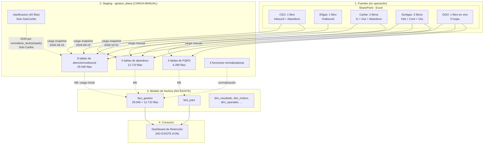
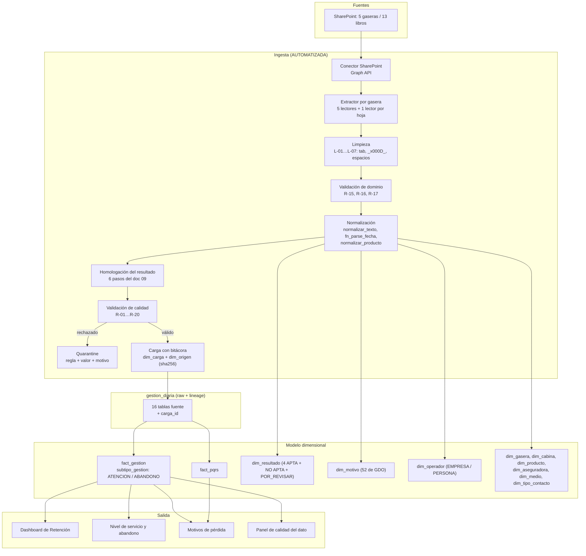

# 🔄 Flujo de Datos - Promigas Gestión Diaria

**Proyecto:** Gestión Diaria Promigas
**Alcance:** esquema `gestion_diaria` de `DataCenter_Promigas`
**Última actualización:** 19 de octubre de 2026

> Describe la arquitectura de flujo de datos **tal como existe hoy** en el esquema
> `gestion_diaria`, y el flujo objetivo. OCM aparece como **destino de la transición**
> (doc 07, pendiente de redactar), no como fuente de datos.

---

## 1. Diagrama del flujo actual (estado real verificado)

### 1.1 Puntos de quiebre del flujo actual

| # | Quiebre | Impacto | Hallazgo |
| ---: | :--- | :--- | :--- |
| 1 | **Carga manual y por snapshot** en el staging | Sin reproducibilidad, sin trazabilidad por lote, sin actualización automática | H-13, H-14 |
| 2 | **No existe el modelo de hechos**: 8 tablas de atención, 4 de abandono y 4 de PQRS sin un destino común | Ningún reporte transversal sin `UNION ALL` de esquemas distintos | H-02 |
| 3 | **El abandono y los PQRS no son analizables por fecha** | 63–100% de las fechas no parseables en 4 tablas | H-09, H-10 |
| 4 | **El catálogo solo cubre GasCaribe** | 43 variantes sin catalogar; 236 filas sin clasificar | H-03, H-31 |
| 5 | **La carga no valida el dominio de las columnas** | 1.589 filas con valores de otra columna | H-24, H-25 |
| 6 | **Sin bitácora ni cuarentena** | Una fila no es rastreable a su archivo; los rechazos no quedan registrados | H-13, H-14 |
| 7 | **Sin claves foráneas ni índices de negocio** | Seq scan por fecha o contrato | H-17 |

---

## 2. Diagrama del flujo objetivo

---

## 3. Reglas de Transformación Obligatorias

### 3.1 Normalización temporal

| Gasera | Columna canónica | Regla | Estado |
| :--- | :--- | :--- | :--- |
| CEO | `fecha_de_ejecucion` | Ignorar `base` | ⚠️ 1 fecha imposible (año 3748) + 5.6% nulos |
| Efigas | `fecha_de_ejecucion` | **Ignorar `base`** (fecha de carga del lote) | ✅ Regla confirmada con datos |
| Gas Caribe | `fecha_de_ejecucion` | `mes` viene como `"ABRIL 2026"` → extraer el año | ⚠️ 2 fechas epoch + 26.1% nulos |
| GDO Inbound | `fecha_de_llamada` | — | ✅ 100% parseable |
| GDO Outbound | `fecha_ejecucion` | `COALESCE(fecha_ejecucion, fecha_de_base)` | ⚠️ 7.1% nulos |
| Surtigas | `fecha_de_ejecucion` | — | ✅ 99.96% poblado |
| *Abandono* | `fecha_llamada` + `hora` | Formato a `timestamptz` | 🔴 63–100% no parseable en GDO/Surtigas |

**Formato destino:** `timestamptz`, con el texto original conservado en `*_raw`.

### 3.2 Homologación de estructuras

| Regla | Fuente | Destino | Estado |
| :--- | :--- | :--- | :--- |
| `informativo` → PQRS | `gdo_informativo` | `fact_pqrs` | ⚠️ Es **bitácora**, no maestro (A-13) |
| Unificación Inbound/Outbound | Todas | `tipo_cabina` | ✅ Funciona |
| Abandono como subtipo | 4 fuentes | `subtipo_gestion='ABANDONO'` | ❌ No implementado (H-02) |
| Normalización de mes | 5 gaseras | `mes_gestion` (12 valores) | ⚠️ 5 formatos de entrada (H-08) |
| Separar año de venta vs de gestión | Todas | `anio_gestion` / `anio_venta` | ❌ No implementado (H-07) |
| Mapeo del resultado por gasera | 7 columnas distintas | `resultado_id` | ⚠️ GDO usa `resultado_final` (H-29) |

### 3.3 Control de calidad

**20 reglas de validación** definidas en `05_Calidad_de_Datos.md` §8, agrupadas en:

* **Rango** (R-01): `fecha_gestion` en `[2025-01-01, hoy+1]`.
* **Completitud** (R-02, R-03, R-12, R-18): fecha, contrato, localidad, operador, motivo, resultado original.
* **Validez y dominio** (R-04, R-05, R-09, R-13, R-15, R-16): estado, mes, tipo de gestión, motivo, operador, canal.
* **Consistencia** (R-07, R-08): `anio_gestion` derivado; clasificación determinista.
* **Unicidad** (R-10): llave natural + marcado de duplicados (no borrado).
* **Formato** (R-06, R-11, R-17): `mes` sin año; teléfono E.164; sin tabuladores ni saltos de línea.
* **Trazabilidad** (R-19, R-20): bitácora con hash y cuarentena.

> **Principio:** los registros que fallan van a **cuarentena**, nunca se descartan en
> silencio. Sin esa bitácora, la reconciliación con el modelo es imposible.

---

## 4. Detalle de las Capas de Almacenamiento

### 4.1 Staging — `gestion_diaria`

| Aspecto | Estado actual | Estado objetivo |
| :--- | :--- | :--- |
| Granularidad | 16 tablas de datos por gasera × cabina × familia | Igual + `carga_id` |
| Trazabilidad de carga | `fecha_carga` solo en 6 tablas, con un único valor | `carga_id` → `dim_carga` en todas |
| Bitácora de ingesta | ❌ No existe | `gestion_diaria.dim_carga` + `dim_origen` |
| Hash del archivo origen | ❌ No existe | `sha256` por lote |
| Validación de dominio | ❌ No existe | R-15, R-16, R-17 |
| Índices de negocio | 0 | (en el modelo, no en el staging) |
| Claves foráneas | 0 | Jerarquía de dimensiones |

### 4.2 Core — modelo dimensional (por crear)

| Aspecto | Estado actual | Estado objetivo |
| :--- | :--- | :--- |
| Modelo | 16 tablas planas independientes | Estrella: `fact_gestion` + `fact_pqrs` + 12 `dim_*` |
| Abandono | 4 tablas sueltas | `fact_gestion` con `subtipo_gestion` |
| PQRS | 4 tablas sueltas | `fact_pqrs` |
| Gasera | implícita en el nombre de la tabla | `dim_gasera` (5 filas) |
| Cabina | implícita en el nombre de la tabla | `dim_cabina` (3 filas) |
| Asesor | `operador` (empresa, H-23) | `dim_operador` con `tipo` ∈ {EMPRESA, PERSONA} |
| Motivo | `subtipificacion` texto libre | `dim_motivo` (52 valores de GDO) |
| Resultado | `estado` texto libre | `dim_resultado` con 4 APTA + NO APTA + POR_REVISAR |
| Clave | `id` serial | `id_gestion` + `clave_natural` (md5) |
| Actualización | Snapshot manual | Incremental diaria con `carga_id` |

---

## 5. Transición a OCM

| Hito | Estado | Nota |
| ---: | :--- | :--- |
| 1. Habilitar API / acceso a datos de OCM | ⬜ Sin verificar | **Doc 07, pendiente** |
| 2. Sustituir los conectores Excel por flujo directo | ⬜ Sin empezar | Depende del hito 3 |
| 3. Casar OCM con las planillas | ⬜ Sin empezar | **Métrica que define todo el hito 2** |
| 4. Cargar abandono y PQRS en el modelo | 🔴 En curso | M3–M6 del doc 03 |
| 5. Archivar y congelar las planillas de SharePoint | ⬜ Sin empezar | |
| 6. Reducir a 0% los errores de tipeo | ⬜ Sin empezar | Depende de 1 y 3 |

> **El trabajo pendiente no es de integración sino de datos y proceso:** medir qué % de
> las gestiones de Excel tiene su llamada registrada en OCM, y decidir gasera por gasera
> si Excel se apaga. Ese número **no existe todavía** y es el entregable central del
> doc 07.

---

## 6. Arquitectura del Dashboard (propuesta)

Construido sobre el **modelo dimensional** (doc 03), no sobre el staging.

| Vista / Panel | Fuente | Métrica | Depende de |
| :--- | :--- | :--- | :--- |
| Resumen ejecutivo | `fact_gestion` | Volumen, APTA/NO APTA, No Contacto | — |
| Panel por gasera | `fact_gestion` | Volumen, distribución de resultado, cobertura | — |
| Nivel de servicio | `fact_gestion` (ABANDONO) | Tasa de abandono por hora/día | **A-12** (GDO) |
| Resultados | `fact_gestion` | Los 4 resultados APTA separados | D-01, D-02 |
| Motivos de pérdida | `fact_gestion` + `dim_motivo` | Distribución de motivos | P-09 (B-28) |
| Operadores | `fact_gestion` + `dim_operador` | Volumen por empresa operadora | **A-11** |
| Calidad del dato | `dim_carga` + `quarantine` | Filas cargadas/rechazadas, `POR_REVISAR` | — |

> ⚠️ **Bloqueos de publicación:**
> * El panel de **resultados** requiere la semántica literal de `APTA` comunicada (H-22).
> * El panel de **operadores** requiere A-11 resuelto.
> * El panel de **abandono** requiere A-12 resuelto (GDO no confiable).
> * El panel de **motivos** requiere el maestro de 52 valores (B-28).
>
> Los paneles de **volumen** y **calidad del dato** se pueden construir de inmediato.

---

## 7. Documentos Relacionados

| Documento | Contenido |
| :--- | :--- |
| `01_Diccionario_de_Datos.md` | Inventario columna por columna y catálogos de tipificación |
| `02_Mapeo_Origen_Destino.md` | Especificación de la ingesta, campo por campo |
| `03_Modelo_Datos.md` | Modelo en estrella y migraciones SQL |
| `04_Hallazgos_y_Backlog.md` | 35 hallazgos y 35 acciones |
| `05_Calidad_de_Datos.md` | Perfil de calidad y 20 reglas de validación |
| `010_Registro_Decisiones_Riesgos.md` | Decisiones, riesgos y preguntas abiertas |
