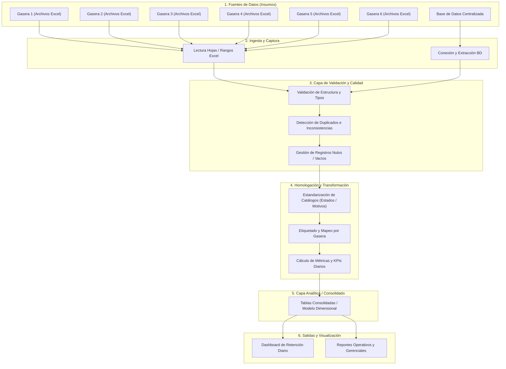

# 🔄 Flujo de Datos - Reporte Gestión Diaria Promigas

Este documento define el ciclo de vida del dato desde su captura en las diferentes gaseras hasta su visualización en el reporte diario de gestión de retención.

---

## 1. Diagrama Conceptual del Flujo de Datos

---

## 2. Etapas Detalladas del Flujo

### Fase 1: Ingesta (Data Ingestion)
* **Fuentes:** Archivos Excel locales o compartidos por cada gasera + consultas a base de datos.
* **Frecuencia:** Diaria.
* **Riesgos analíticos a controlar:**
  * Variabilidad en el nombre de las columnas entre versiones de archivo.
  * Presencia de encabezados múltiples o filas combinadas en Excel.
  * Cambios de codificación (UTF-8, Latin-1, ANSI).

### Fase 2: Validación y Limpieza (Data Quality & Cleansing)
* **Validaciones obligatorias:**
  * Formato de fechas consistente (evitar ambigüedad DD/MM vs MM/DD).
  * Limpieza de strings (espacios extras, caracteres especiales, mayúsculas/minúsculas).
  * Unicidad de registros según la clave de gestión definida.

### Fase 3: Homologación de Negocio (Business Mapping)
* Unificación de conceptos entre las 5 o 6 gaseras:
  * ¿Cómo llama cada gasera al estado "Retenido"? (Ej: "Éxito", "Efectivo", "Retención Lograda").
  * ¿Cómo clasifica a los no contactados?
  * Homologación de motivos de retiro / reclamo.

### Fase 4: Almacenamiento y Salida (Data Serving)
* Generación del dataset maestro unificado para alimentar el tablero de control sin duplicidad de esfuerzo.

---

## 3. Matriz de Control de Calidad del Dato
* [ ] Auditoría de integridad referencial.
* [ ] Conteo de registros input vs output por gasera.
* [ ] Registro de logs de rechazo o inconsistencias (registros con error para retroalimentación operativa).
