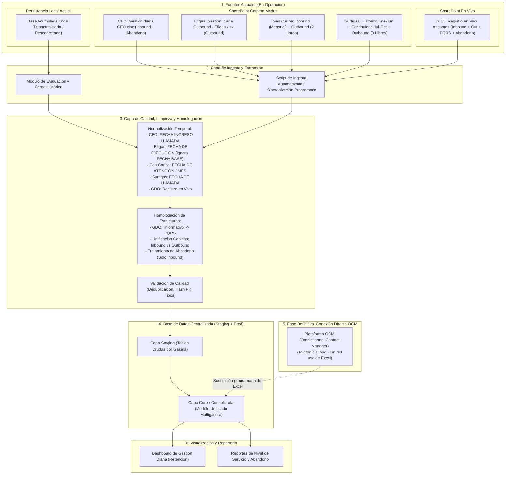

# 🔄 Flujo de Datos Corregido y Actualizado - Promigas Gestión Diaria

> **Actualización según Especificación Técnica Oficial Promigas.**  
> Este documento describe la arquitectura de flujo de datos en dos horizontes temporales: **Fase de Contingencia/Transición (Excel SharePoint)** y **Fase Estratégica Definitiva (OCM + DB Central)**.

---

## 1. Diagrama de Flujo de Datos (Arquitectura de Transición y Destino)

---

## 2. Etapas Detalladas del Flujo de Datos

### Etapa 1: Ingesta de Fuentes Heterogéneas
* **SharePoint Operativo:** Los asesores y supervisores alimentan carpetas por gasera en SharePoint.
  * **Casos particulares de lectura:**
    * **CEO:** Lectura de pestañas `Gestion Diaria Inbound Ceo` y `Abandono`.
    * **Efigas:** Lectura de pestaña única `base efigas`.
    * **Gas Caribe:** Lectura multi-pestaña por mes en libro Inbound + lectura de libro Outbound.
    * **GDO:** Lectura directa del archivo de validación en vivo.
    * **Surtigas:** Fusión de libro histórico recuperado (Ene-Jun) con libro de continuidad (Jul-Oct) y libro Outbound.
* **Base Acumulada Local:** Se someterá al plan de decisión (Truncar, Modificar o Reemplazar) para la carga masiva inicial.

### Etapa 2: Reglas de Transformación y Homologación Obligatorias
1. **Regla de Filtro de Fechas en Efigas:**
   * La columna `FECHA BASE` contiene la fecha de asignación/carga del lote. **Debe descartarse**.
   * La columna analítica válida es `FECHA DE EJECUCION`.
2. **Regla de Homologación en GDO:**
   * La pestaña `informativo` debe ser absorbida bajo la categoría **PQRS Escritas**, estandarizando sus campos al modelo de reclamos.
3. **Regla de Tráfico (Inbound vs Outbound):**
   * Las llamadas de **Abandono** aplican estrictamente a la operación Inbound (CEO, Gas Caribe, GDO, Surtigas). No existen en Outbound (Efigas ni registros Out).
4. **Normalización de Formatos de Fecha:**
   * Unificación de columnas de fecha heterogéneas (`FECHA INGRESO LLAMADA`, `FECHA DE ATENCION`, `FECHA DE LLAMADA`, `FECHA DE EJECUCION`) a un formato estándar `YYYY-MM-DD HH:MM:SS`.

### Etapa 3: Almacenamiento Centralizado (DB Relacional)
* **Tabla Staging:** Carga espejo de cada hoja/gasera sin transformaciones destructivas.
* **Tabla Hechos (Fact_Gestion_Diaria):** Tabla transaccional consolidada donde cada registro contiene:
  * `id_gestion` (PK sintética)
  * `gasera` (CEO, EFIGAS, GAS_CARIBE, GDO, SURTIGAS)
  * `tipo_cabina` (INBOUND, OUTBOUND)
  * `subtipo_gestion` (ATENCION, ABANDONO, PQRS)
  * `fecha_gestion` (Fecha unificada)
  * `campos_operativos` (Contrato, Agente, Tipificación, Retención, etc.)

### Etapa 4: Transición Estratégica hacia OCM
* Se establece una **fecha límite operativa** para el llenado de planillas Excel.
* Una vez desplegado **OCM (Omnichannel Contact Manager)**, la ingesta pasará a ser directa por API / base de datos del contact center cloud hacia la DB central de Promigas, eliminando por completo los errores de transcripción humana en Excel.
